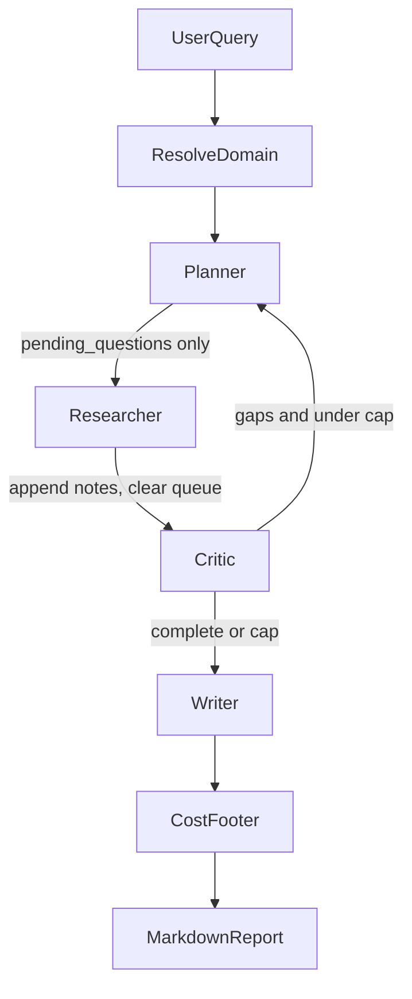
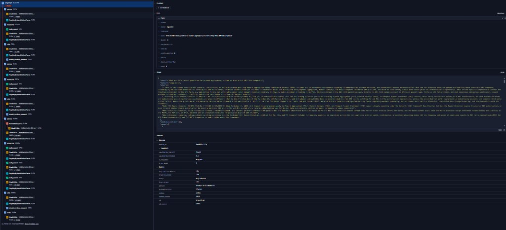

# FinSight Agent

[](https://github.com/rohil01/Deep-Dive-Research-Agent/actions/workflows/ci.yml)

FinSight Agent is an autonomous research analyst for Indian fintech. Ask it about RBI regulation or the payments market and it returns a cited Markdown report with the estimated cost of producing it.

**Python, LangGraph, Tavily, NVIDIA NIMs**

- A cyclic LangGraph loop decomposes a question into sub-questions, searches only the ones still unanswered, and stops when a critic finds the evidence sufficient or the iteration cap is hit.
- Regulatory runs search RBI, NPCI, SEBI, and PIB; market runs search Mint, Economic Times, Moneycontrol, MediaNama, Inc42, and Entrackr. Tavily results and scraped pages are kept only when a structured relevance check says they answer the question.
- Reports are written by an NVIDIA NIM, with per-call token and cost totals, an LLM-as-judge eval harness, optional LangSmith traces, tests and CI, Docker, and a streaming FastAPI endpoint.

Demo question: *What are RBI's latest guidelines for payment aggregators, and how do they affect UPI-first companies?*

## Quick start

Python 3.11 or 3.12.

```bash
pip install -e ".[dev]"
# copy .env.example .env   on Windows;  cp .env.example .env  on macOS/Linux
# then fill in NVIDIA_API_KEY and TAVILY_API_KEY
finsight research "What are RBI's latest guidelines for payment aggregators, and how do they affect UPI-first companies?" --domain regulatory --max-iterations 3 -o report.md
```

Omit `--domain` and a cheap classifier chooses `regulatory`, `market`, or `general`. `python research_agent.py "your query"` still works and forwards to the same CLI.

Keys: [NVIDIA API](https://build.nvidia.com/settings/api-keys) and [Tavily](https://tavily.com). The default models are NVIDIA NIMs: `nvidia/nemotron-3-super-120b-a12b` for the research loop and `nvidia/nemotron-3-nano-30b-a3b` for domain classification.

## Docker

```bash
docker build -t finsight .
docker run --rm --env-file .env finsight research "What are RBI's latest guidelines for payment aggregators, and how do they affect UPI-first companies?" --domain regulatory -o report.md
```

The image runs as a non-root user. `-o report.md` writes inside the container. Mount the working directory to keep the file:

```bash
# Windows
docker run --rm --env-file .env -v "%cd%":/work -w /work finsight research "your query" --domain regulatory -o report.md

# macOS / Linux
docker run --rm --env-file .env -v "$PWD":/work -w /work finsight research "your query" --domain regulatory -o report.md
```

The image does not contain `.env`. Pass it with `--env-file`.

## API

```bash
uvicorn finsight.api:app --host 0.0.0.0 --port 8000
```

`POST /research` streams server-sent events from the LangGraph run: a `node` event for each step, then a `report` event whose Markdown includes the cost footer.

```bash
curl -N -X POST http://127.0.0.1:8000/research -H "Content-Type: application/json" -d "{\"query\":\"What are RBI's latest guidelines for payment aggregators?\",\"domain\":\"regulatory\",\"max_iterations\":3}"
```

## Domains

| Domain | Search limited to | Report adds |
| --- | --- | --- |
| regulatory | rbi.org.in, npci.org.in, sebi.gov.in, pib.gov.in | Regulatory Implications, Compliance Timeline, circular number and date |
| market | livemint.com, economictimes.indiatimes.com, moneycontrol.com, medianama.com, inc42.com, entrackr.com | Players, shares, volumes, and the dates those figures refer to |
| general | open web | Executive summary, findings, analysis, citations, conclusion |

## How a run moves



The planner writes only new sub-questions into `pending_questions`. The researcher searches that queue and clears it. `notes`, `plan`, and `usage` accumulate through an append reducer, so each node returns only the items it added. The critic stops at `MAX_ITERATIONS` (default 3) even if gaps remain. A critique or report that fails to parse does not crash the run: the critic approves what was gathered, and the writer emits a short fallback from the raw summaries.

## Engineering highlights

- **State duplication.** `notes` and `plan` use an append reducer. Nodes that returned the whole state re-appended every note on each loop, so reports grew copies of the same research. Nodes now return only the keys they change, and only the new notes or questions.
- **Repeated searches.** The researcher used to walk the full plan every iteration. `pending_questions` is the work queue: answered questions stay in `plan` and are not searched again.
- **Structured outputs.** Planner, search analysis, critic, and domain classification parse Pydantic models from a JSON-schema response. The writer still returns Markdown. Token counts are read from that chat message, because the NVIDIA client does not return usage alongside a parsed object.
- **Fail-open critic and writer.** A broken critique ends the loop and still produces a report. A broken writer returns the summaries already gathered instead of raising.

## Cost

Every report ends with a **Run cost (estimated)** table: per-call node, model, and input/output tokens, plus a USD estimate. The CLI prints the same totals. Rates are `PRICE_INPUT_PER_MILLION` and `PRICE_OUTPUT_PER_MILLION` in `.env` (defaults are estimates, not an invoice). Token counts come from provider usage metadata.

## Evals

[evals/questions.yaml](evals/questions.yaml) holds eight fintech questions with expected-coverage keywords. `python evals/run_evals.py` runs each one and asks the fast NVIDIA NIM to score coverage, citation presence, citation faithfulness, and structure. It writes [evals/results.json](evals/results.json) and [evals/results.md](evals/results.md). The checked-in table is a placeholder until that command has been run with API keys. The script exits without inventing scores when a key is missing.

## Sample reports

Commands for a regulatory PA-guidelines report and a UPI market-share report are in [examples/README.md](examples/README.md). The Markdown files are added after a keyed run.

## Tracing

LangSmith stays off unless you opt in. Set `LANGSMITH_TRACING`, `LANGSMITH_API_KEY`, and `LANGSMITH_PROJECT` (or the older `LANGCHAIN_TRACING_V2` / `LANGCHAIN_API_KEY` / `LANGCHAIN_PROJECT` names) as listed in [.env.example](.env.example). A traced regulatory run in the `finsight` project:



## Development

```bash
ruff check src tests evals
pytest
```

CI runs that pair on Python 3.11 and 3.12.

## Layout

```
src/finsight/     agent package (CLI, graph, API)
docs/             traced-run screenshot
evals/            question set and judge harness
examples/         commands for sample reports
research_agent.py shim onto the CLI
```
